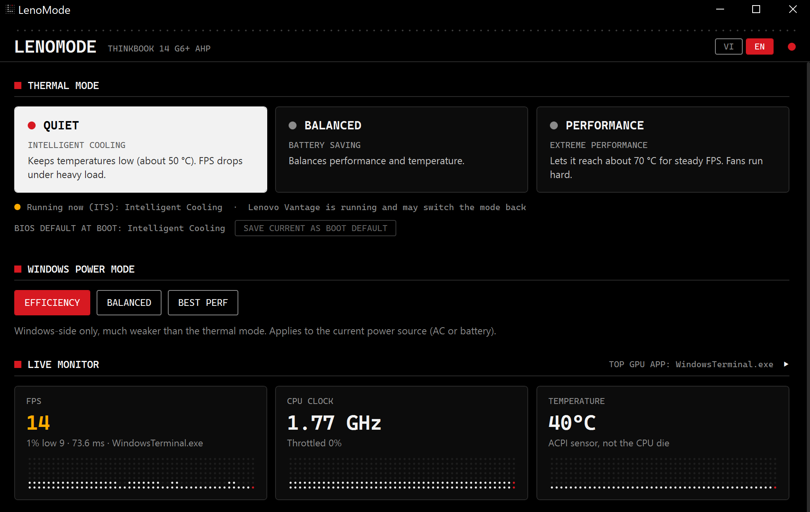

<div align="center">



# LenoMode — thermal mode switcher and gaming monitor for Lenovo ThinkBook

<p>
<a href="https://github.com/Liuchijang/LenoMode/releases/latest"></a>
<a href="https://github.com/Liuchijang/LenoMode/releases"></a>
<a href="https://github.com/Liuchijang/LenoMode/stargazers"></a>
<a href="LICENSE"></a>
</p>
<p>


</p>

LenoMode switches the Lenovo <b>Thermal mode</b> live from Windows, reads it back after every change,<br>
and shows what each mode does to FPS, CPU clock, temperature and power while you play.<br>
English or Vietnamese, in a monochrome dot-matrix style.

<p>
<strong>Switches</strong><br>
Quiet · Balanced · Performance · Windows power mode · BIOS boot default
</p>
<p>
<strong>Measures</strong><br>
FPS and 1% low · Game GPU · CPU load and clock · Temperature · System power · RAM · GPU memory
</p>

</div>

## Quick Start

Download `LenoMode.exe` from [Releases](https://github.com/Liuchijang/LenoMode/releases/latest) and run it.
No installer and no admin rights: it needs only .NET Framework 4.8, which Windows 10 and 11 already include.

To build it yourself, no SDK is needed — `build.ps1` uses the C# compiler that ships with .NET Framework:

```powershell
git clone https://github.com/Liuchijang/LenoMode.git
cd LenoMode
powershell -ExecutionPolicy Bypass -File build.ps1   # -> bin\LenoMode.exe
```

> [!NOTE]
> Made for and tested on the **ThinkBook 14 G6+ AHP** (Ryzen 7 8845H, Radeon 780M) only.
> Other Lenovo models may expose a different thermal interface.

## Features

<table>
<tr>
<td width="33%" valign="top">🌡️ <b>Live thermal mode</b><br>Quiet / Balanced / Performance through the Lenovo energy driver — the same path as Fn+Q and Vantage — and read back before the UI shows it.</td>
<td width="33%" valign="top">🎮 <b>FPS without extra tools</b><br>Frames per process from the DXGI / D3D9 Present ETW events, the source PresentMon uses. FPS, 1% low and frame time.</td>
<td width="33%" valign="top">📊 <b>Live monitor</b><br>Nine tiles with a dot-matrix history each. Collapsed, it keeps the three that matter: FPS, CPU clock, temperature.</td>
</tr>
<tr>
<td valign="top">⚖️ <b>Mode comparison</b><br>REC averages per mode; AUTO TEST runs all three modes in turn and restores the one you had. CSV export.</td>
<td valign="top">🪟 <b>In-game overlay</b><br>Click-through and always on top. Pick the fields, size, background, panel or one line, a corner or drag it anywhere.</td>
<td valign="top">⌨️ <b>Hotkeys inside the game</b><br><code>Ctrl+Alt+1/2/3</code> switch the mode, <code>Ctrl+Alt+O</code> toggles the overlay.</td>
</tr>
<tr>
<td valign="top">🔋 <b>Windows power mode</b><br>The Settings power slider, for the power source in use (AC or battery).</td>
<td valign="top">💾 <b>BIOS boot default</b><br>Saves the current mode as the BIOS <code>SystemPerformanceMode</code>, which applies at the next boot. One UAC prompt.</td>
<td valign="top">🧭 <b>Tray and autostart</b><br>Closing hides to the tray; <i>Start with Windows</i> launches it hidden. Single instance.</td>
</tr>
</table>

## Thermal Modes

| LenoMode | Lenovo name | What to expect |
|---|---|---|
| **Quiet** | Intelligent Cooling | Keeps temperatures low (about 50 °C); FPS drops under heavy load |
| **Balanced** | Battery Saving | Balances performance and temperature |
| **Performance** | Extreme Performance | Lets it reach about 70 °C for steady FPS; fans run hard |

Lenovo Vantage can switch the mode back on its own. LenoMode says so in the status line when Vantage is running.

## How It Works

<details>
<summary>Data flow</summary>

```
EnergyDrv DYTC (live) ─► Its.cs ─┐ Thermal facade (live mode, else BIOS)
Lenovo WMI (root\WMI) ──► LenovoWmi.cs ──┘ (BIOS value = boot default only)
ETW DXGI/D3D9 Present ─► FrameCounter.cs ─► Sensors.cs (FPS)
PerfCounters + WMI ──► Sensors.cs ─(1 s, sampler thread)─► Main.cs ─► tiles / comparison / CSV / Overlay.cs
powrprof overlay ──► Windows power mode
```

</details>

- The app runs **without admin**. Only the ACPI temperature needs it — use *Restart as admin*.
- Saving the BIOS boot default runs an elevated copy of the same exe for that one write.
- Settings live in `%APPDATA%\LenoMode`; CSV files go to `Documents\LenoMode`.

## Limits

- Temperature is the **ACPI thermal zone**, not the CPU die.
- System power is only measurable **on battery**; the Radeon 780M exposes no power sensor to Windows.
- GPU % is not FPS. FPS covers **DirectX** games only (Vulkan and OpenGL are not seen).
- The overlay does not show over **exclusive fullscreen** — use borderless or windowed.

<details>
<summary>Project layout</summary>

| File | Role |
|---|---|
| `src/Its.cs` | Live thermal mode via EnergyDrv DYTC, `Thermal` facade |
| `src/LenovoWmi.cs` | BIOS boot-default thermal mode, Windows power mode |
| `src/FrameCounter.cs` | Real-time ETW session for Present events |
| `src/Sensors.cs` | Perf counters, WMI temperature and battery |
| `src/Overlay.cs` | In-game overlay window |
| `src/CpuStress.cs` | Fixed all-core load for the auto test |
| `src/Main.cs` | Window logic, comparison stats, auto test, CSV |
| `src/Tray.cs` | Tray icon, menu, HKCU Run autostart |
| `src/Ui.cs` | Palette, dot-matrix field, charts and tiles |
| `src/MainWindow.xaml` | Layout and styles, embedded and loaded at runtime |
| `src/Strings.cs` | English / Vietnamese strings, settings |

`assets\make-icon.ps1` regenerates the icon.

</details>

## Safety

LenoMode writes only the thermal mode: the live mode through the Lenovo energy driver, and
`SystemPerformanceMode` when you save a boot default. It changes no other BIOS setting and does no
undervolting. Use it at your own risk.

## License

[MIT](LICENSE).

---

<div align="center">

**Star this repository if LenoMode helps your ThinkBook run cooler or faster.**

Made by [Liuchijang](https://github.com/Liuchijang)

</div>
